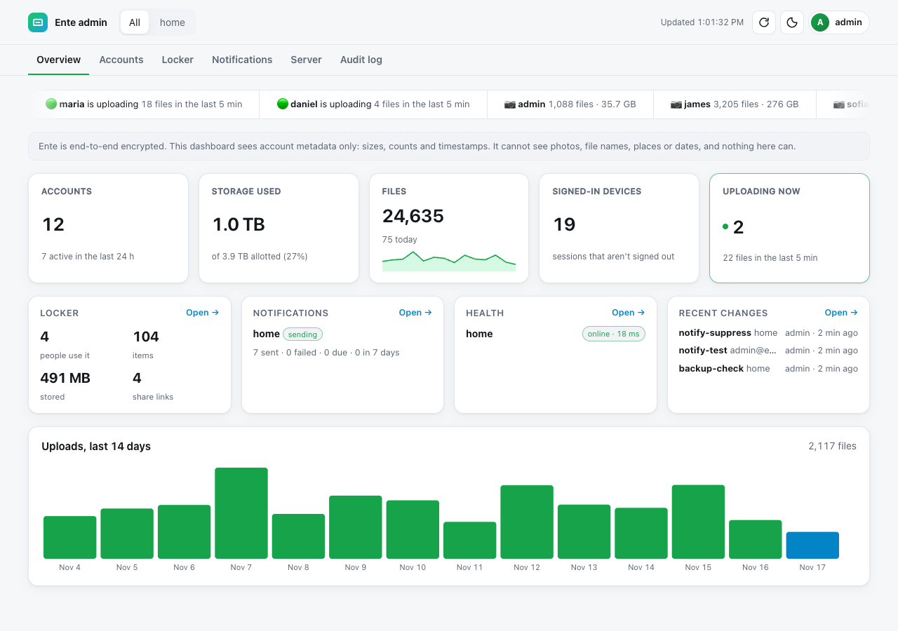
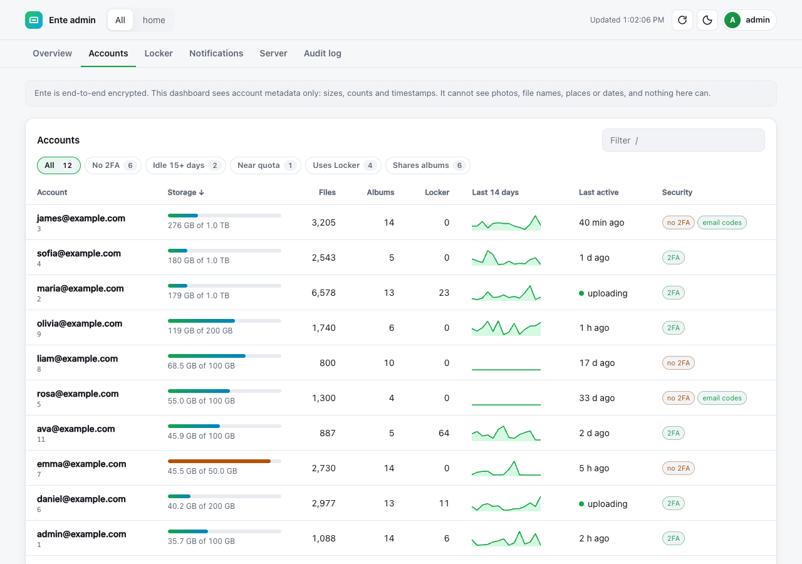
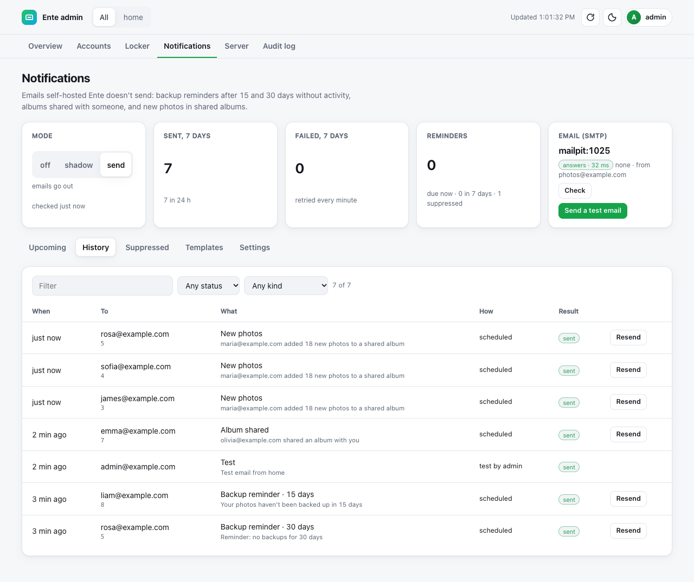
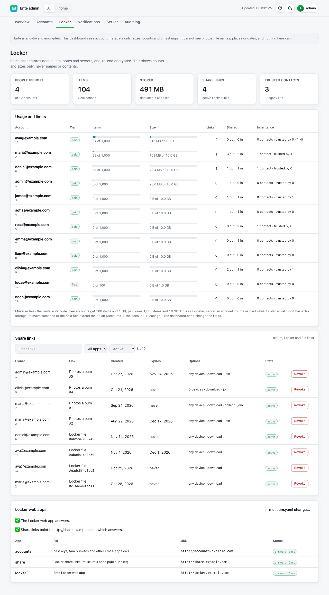
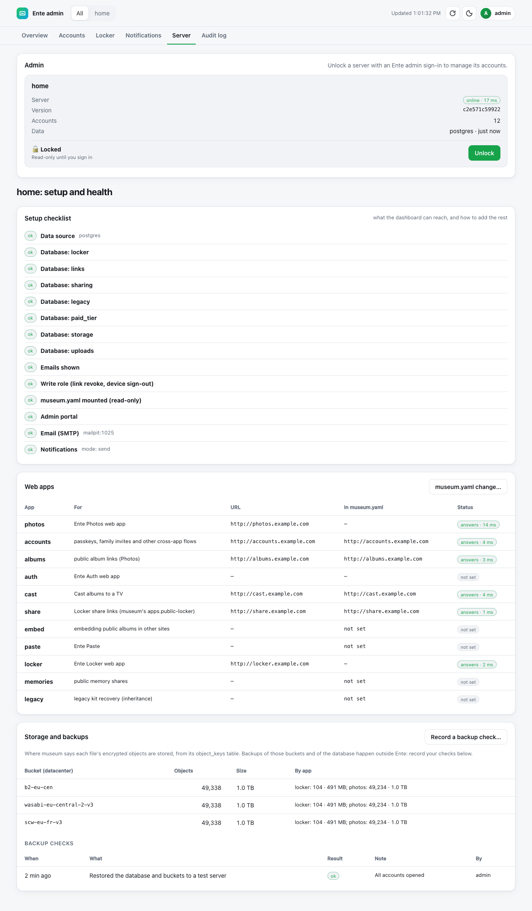
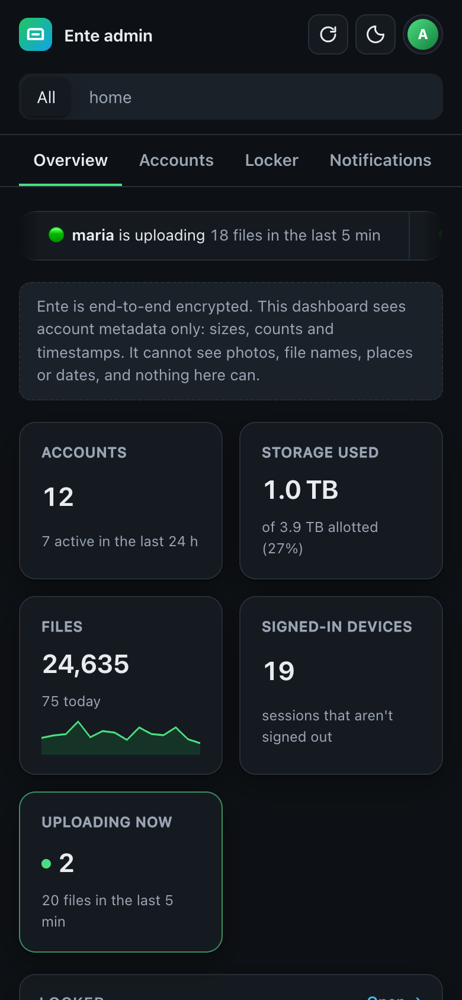
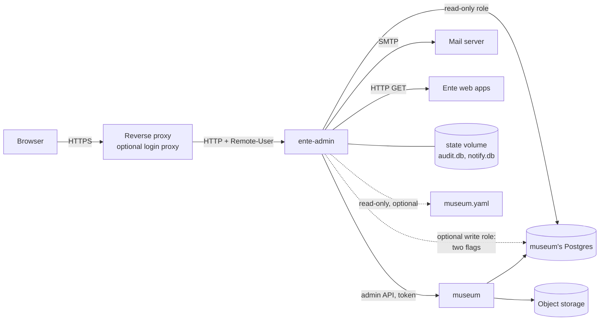
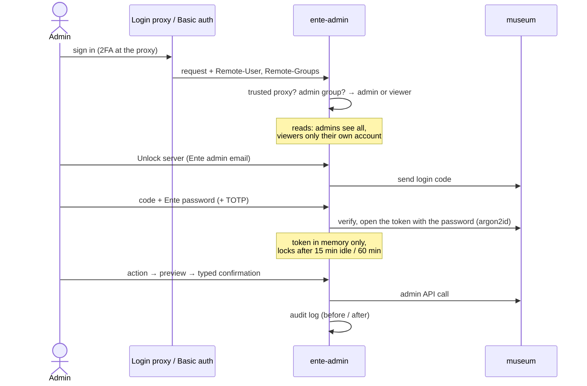
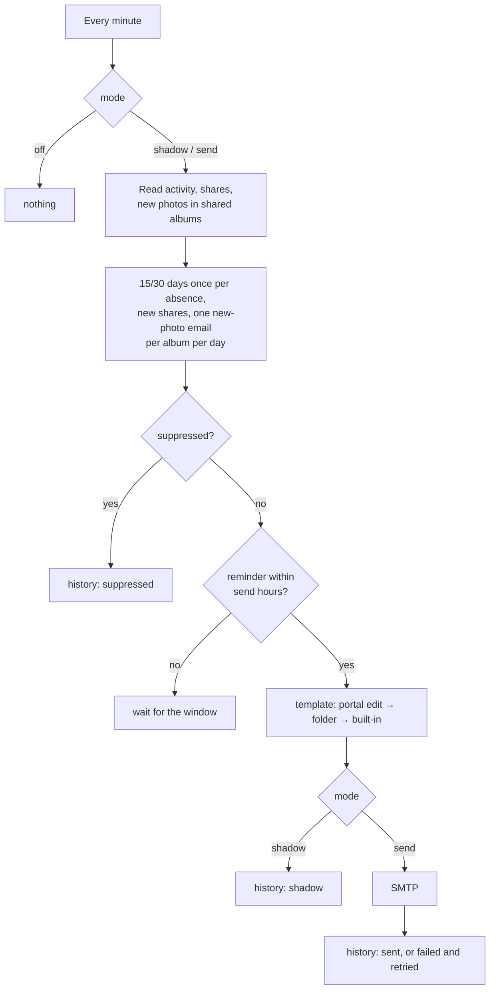
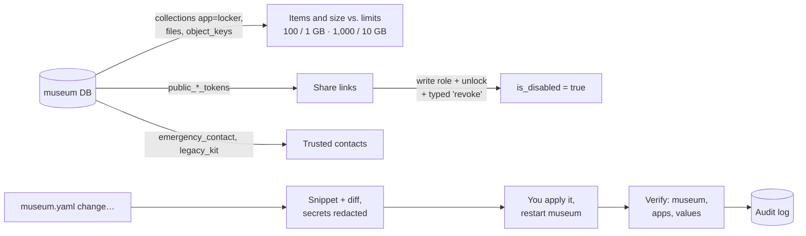

# ente-admin

Hello! I run [Ente Photos](https://ente.com) at home on my k3s cluster. The platform is set up by
[ansible-k3s-homelab](https://github.com/mipapi1/ansible-k3s-homelab), and the apps live in
[k3s-homelab-apps](https://github.com/mipapi1/k3s-homelab-apps). Recently I started letting family
and friends keep their photos and videos on my Ente servers, where they stay end-to-end encrypted.

Running Ente for other people means doing the admin side too, and self-hosted Ente has no easy,
friendly way to do that. Each small request meant digging through CLI commands, API calls and SQL.
So I built ente-admin: one page where I can see how everyone's doing and take care of their
accounts.

---

An admin dashboard for self-hosted [Ente](https://ente.com) servers. It covers accounts,
storage, devices and upload activity, Ente Locker, public links, and the emails self-hosted
Ente doesn't send. An optional admin portal handles the account changes you would
otherwise make with the Ente CLI, curl or SQL. One container, no external calls, login
required.



**Ente is end-to-end encrypted.** A server knows only account metadata: sizes, counts and
timestamps. So does this dashboard. It can't show photos, documents, file names, places or
dates, and it doesn't pretend to. Emails and account ids are masked by default.

## Why

Running Ente yourself means running its admin tasks yourself:

- raising someone's storage;
- turning off two-factor for someone who lost their phone;
- finding out who stopped backing up;
- checking that a share link was revoked;
- checking that the mail server still works.

Without a dashboard, that's a mix of `ente admin` commands, museum API calls, SQL and
scripts. ente-admin puts these tasks on one page. Every change is previewed, confirmed and
written to the audit log, and the dashboard never gets more access than you give it.

## Features

| Area | What you get |
|---|---|
| **Overview** | accounts, storage used vs. allotted, files, signed-in devices, uploads now, Locker, notifications, server health, recent changes |
| **Accounts** | search, sort, quick filters (no 2FA, idle 15+ days, near quota, uses Locker, shares albums); per account: storage, files, albums, trash, devices, Locker, sharing, notifications |
| **Locker** | items and size against the free/paid limits, share links (filter, revoke), trusted contacts and legacy kits, web app checks |
| **Notifications** | backup reminders at 15 and 30 days, album-shared and new-photo emails; upcoming, history, resend, send now, suppress, template editor with preview, SMTP check, test emails; off / shadow / send |
| **Server** | setup checklist with the exact grants that are missing, web app checks, storage per bucket and files with missing copies, backup check log, museum.yaml change builder (diff, then verify) |
| **Admin portal** | storage and plan, extra storage, two-factor, passkeys, email codes, email change, family plan, account deletion, device sign-out, all after an Ente admin sign-in |
| **Audit log** | who did what, when, on which account, with the values before and after |
| **Everywhere** | light and dark, phones, keyboard (`/` search, `t` theme), your own branding, viewers who see only their own account |

| Accounts | Notifications |
|---|---|
|  |  |
| **Locker** | **Server** |
|  |  |
| **Phone, dark** | |
|  | |

*Screenshots: a throwaway test server filled with made-up accounts and data.*

## Quick start

```bash
git clone https://github.com/mipapi1/ente-admin.git && cd ente-admin
cp .env.example .env && mkdir -p secrets
printf 'admin:' > secrets/users
docker compose run --rm ente-admin hash-password | tr -d '\r' >> secrets/users
docker compose up -d     # demo mode: synthetic data, no Ente server needed
```

Open http://localhost:8001. To connect your server, follow **[docs/SETUP.md](docs/SETUP.md)**:

1. prerequisites;
2. museum admins;
3. the admin token;
4. Photos data (postgres);
5. the portal, Locker and email;
6. reverse proxy;
7. upgrading.

Other ways to run it:

| Setup | Guide |
|---|---|
| Next to Ente's quickstart (`my-ente`) | [deploy/compose](deploy/compose/README.md) |
| Kubernetes (kustomize) | [deploy/kubernetes](deploy/kubernetes/README.md) |
| No Docker (pip + systemd) | [deploy/standalone](deploy/standalone/README.md) |

## How it works



### Data flow

| From | What | Used for |
|---|---|---|
| museum's admin API | accounts, quota, plan, two-factor, devices | the `museum` source, and every portal action |
| museum's database (read-only role) | users, usage, files and albums (ids, sizes, times), devices (never the token), Locker collections, public links, shares, legacy contacts, object locations | the `postgres` source, Locker, links, storage, notifications |
| museum's database (optional write role) | `is_disabled` on public links, `is_deleted` on sessions | revoking a link, signing out a device |
| museum.yaml (read-only, optional) | `apps`, `internal.admins`, `internal.disable-registration` | config diffs; secrets are redacted before anything is shown |
| SMTP | outgoing email only | notifications, test emails |
| Ente web apps | an HTTP GET | "answers" checks |

Nothing reads object storage, decrypts user content, or talks to anything outside your
network except your mail server.

### Sign-in and permissions



### Notifications



### Locker and museum.yaml



## What it can do

| Feature | What | How | Role | Destructive |
|---|---|---|---|---|
| Accounts, storage, files, devices | list and details | admin API `GET /admin/users`, `GET /admin/user` (CLI `list-users`, `get-user-id`), or DB read | viewer (own) / admin | N |
| Uploads per day, uploading now, albums, trash | charts and counts | DB read (`files`, `collections`, `trash`) | viewer / admin | N |
| Change plan storage and expiry | free plan only | `PUT /admin/user/subscription` (CLI `update-subscription`) | admin + unlock | N (reversible) |
| Extra storage add / change / remove | support add-on | `POST /admin/user/bonus` | admin + unlock | N |
| Turn off two-factor | | `POST /admin/user/disable-2fa` (CLI `disable-2fa`) | admin + unlock, typed email | Y |
| Remove passkeys | | `POST /admin/user/disable-passkeys` (CLI `disable-passkey`) | admin + unlock, typed email | Y |
| Email code at sign-in | on / off | `POST /admin/user/update-email-mfa` | admin + unlock | N |
| Change email | | `PUT /admin/user/change-email` | admin + unlock, typed email | Y |
| Close family plan | | `POST /admin/user/close-family` | admin + unlock, typed email | Y |
| Allow sign-in after storage warning | | `POST /admin/user/unblock-storage-warning-login` | admin + unlock | N |
| Delete account | | `DELETE /admin/user/delete` (CLI `delete-user`) | admin + unlock, typed `delete <email>` | **Y** |
| Server test email | museum's mailer | `POST /admin/mail` (CLI `send-mail`) | admin + unlock | N |
| Devices | list | DB read `tokens` (never the token column) | admin | N |
| Sign out a device | | DB write `tokens.is_deleted` (write role) | admin + unlock, typed `sign out` | Y |
| Locker usage and limits | per person | DB read `collections`, `collection_files`, `object_keys`, `storage_bonus` | admin | N |
| Public links | Locker, albums, files | DB read `public_collection_tokens`, `public_file_tokens` | admin | N |
| Revoke a public link | | DB write `is_disabled` (write role) | admin + unlock, typed `revoke` | Y |
| Sharing, trusted contacts, legacy kits | counts and states | DB read `collection_shares`, `emergency_contact`, `legacy_kit` | admin | N |
| Storage per bucket, missing copies | | DB read `object_keys.datacenters` | admin | N |
| Backup check log | record a restore test | state volume (audit log) | admin | N |
| Web app checks | Photos, Locker, share, albums, accounts… | HTTP GET | admin | N |
| museum.yaml change | apps, admins, sign-ups | snippet + diff of the read-only file; you apply it; Verify | admin | N (writes nothing) |
| Setup checklist | missing grants and settings | DB `has_column_privilege`, config | admin | N |
| Backup reminders, share and new-photo emails | automatic | DB read + SMTP | — (by mode) | N (sends email) |
| Send now, resend, test email | | SMTP | admin | N (sends email) |
| Suppress, templates, thresholds, send hours, mode | | state volume | admin; typed `send emails` to start sending | N |
| Import ente-notify state | | state volume | admin | N |
| Share accounts with viewers | | state volume | admin | N |
| Audit log | | state volume | admin | — |

Each hand-done task and where it is now: [docs/TASKS.md](docs/TASKS.md). Museum endpoints
left out on purpose, and why: [docs/ADMIN.md](docs/ADMIN.md#left-out-on-purpose).

### What it can't do

- **See content.** Photos, documents, notes, file and album names, places, dates: all
  encrypted on the device.
- **Reset passwords.** With end-to-end encryption the password protects the keys; people
  use their recovery key.
- **Change Locker limits.** Museum hardcodes them; the dashboard can move someone to the
  paid tier by extending their plan or adding extra storage.
- **Write museum.yaml, restart museum, run SQL, shell, kubectl or Docker.** None of these
  are exposed in a browser. Config changes are shown as a diff for you to apply.
- **Grant itself database access.** It prints the GRANT lines; a superuser runs them.
- **Read session tokens, sign in as a user, or set someone's login code.**
- **Create accounts.** Sign-up goes through the apps.
- **Back up anything.** It shows where files are and records your restore tests.

## Permissions

| Access | Gives | Without it | How |
|---|---|---|---|
| Dashboard login (Basic or login proxy) | the page | won't start | [docs/SECURITY.md](docs/SECURITY.md) |
| Admin group (`ADMIN_GROUPS`) | admins see everything; others only their own account | everyone is an admin | login proxy groups |
| Admin token (museum source) | accounts, quota, plan, devices | use the postgres source | `ente account get-token` |
| Read-only DB role | detail, Locker, links, storage, notifications | museum source only; those sections say what's missing | [docs/POSTGRES.md](docs/POSTGRES.md) |
| Optional column grants | each feature on its own | that feature names the missing grant | Server → Setup checklist |
| museum's `key.encryption` | emails (postgres source) | accounts shown by label | `EMAIL_KEY_FILE` |
| Ente admin sign-in (`internal.admins`) | portal actions, per session | read-only | Unlock on the page |
| Write role | link revoke, device sign-out | those buttons hidden | [docs/POSTGRES.md](docs/POSTGRES.md#optional-write-role) |
| SMTP | notifications, test emails | notifications only in shadow | [docs/NOTIFICATIONS.md](docs/NOTIFICATIONS.md) |
| museum.yaml (read-only) | current values and diffs | snippets only | `MUSEUM_CONFIG_FILE` |
| Shell, S3, secrets store, kubectl | never needed | — | — |

## Configuration

Environment variables or a TOML file: [docs/CONFIG.md](docs/CONFIG.md),
[.env.example](.env.example), [config.example.toml](config.example.toml). Security notes and
a hardening checklist: [SECURITY.md](SECURITY.md).

## Troubleshooting

| Symptom | Cause and fix |
|---|---|
| `configuration error: authentication is required` | Set `ENTE_ADMIN_USERS_FILE`, or use header auth with `TRUSTED_PROXIES`. |
| `403 forbidden` behind a proxy | The proxy's address isn't in `ENTE_ADMIN_TRUSTED_PROXIES`, or the header name differs (`TRUSTED_HEADER`). |
| Account list empty or stale (museum source) | Museum lists accounts only for a token < 10 minutes old: put a fresh one in `FRESH_TOKEN_FILE`, or use the postgres source. |
| Emails shown as `acct-xxxxxxxx` | Masking is on (`REVEAL_EMAILS`), or the postgres source has no `EMAIL_KEY_FILE`. |
| A section says it needs grants | Server → Setup checklist shows the GRANT lines; run them as a superuser. |
| Unlock: "not an admin" | Add the account's id under `internal.admins` in museum.yaml and restart museum. |
| Unlock is slow or the container restarts | Key derivation needs memory: give the container 512 MiB (`KDF_MAX_MIB`). |
| Turning off two-factor or deleting is refused | Museum wants a sign-in from the last 10 minutes: lock and unlock again. |
| SMTP check fails | Host, port and `SECURITY` (`starttls` on 587, `ssl` on 465); `USERNAME` and `PASSWORD_FILE`; outbound port open. |
| Emails land in spam | SPF and DKIM for the `From` domain at your mail provider. |
| Reminders don't go out | Mode is `shadow`, it's outside the send hours, the person is suppressed, or they were already reminded this absence (Notifications → Upcoming says which). |
| Revoke or Sign out buttons missing | No write role (`WRITE_DSN`), or the server isn't unlocked. |
| A revoked link still opens | Museum caches links for about a minute. |
| A Locker app shows "not set" | Add its URL to `<NAME>_APPS`; set `apps.public-locker` in museum.yaml for share links. |
| No museum.yaml diff | Mount the file read-only and set `MUSEUM_CONFIG_FILE`; otherwise you get a snippet. |

## FAQ

**Is it safe to point at my production server?** It's read-only by default: a read-only
database role, or a token used only for reads. Turn on the portal and the write role only
when you need them, and try changes on a test server first.

**Does it replace the Ente CLI?** For day-to-day account administration, yes; it calls the
same museum endpoints. Server setup, migrations and backups stay with your usual tools.

**Why do notifications need the database?** Museum's API doesn't report activity per
account or new shares; the database does, read-only.

**Can I keep my own reminder script?** Yes: run notifications in `shadow` to compare, import
the script's state, then switch over ([docs/NOTIFICATIONS.md](docs/NOTIFICATIONS.md)).

**Several servers?** Any number, each with its own source, SMTP and notification mode.

**Is it affiliated with Ente?** No. It's an independent project for people who self-host
Ente.

## Development

```bash
pip install -e '.[dev,postgres]'
ENTE_ADMIN_DEMO=true ENTE_ADMIN_AUTH=none ENTE_ADMIN_INSECURE_LOCALHOST=true python -m ente_admin
pytest && ruff check .
IMAGE=ente-admin:dev tests/e2e/run.sh     # real museum in Docker (Ente's quickstart), synthetic account
```

Contributions welcome, see [CONTRIBUTING.md](CONTRIBUTING.md). Security reports:
[SECURITY.md](SECURITY.md).

## License

MIT. Ente is a trademark of its owners.
